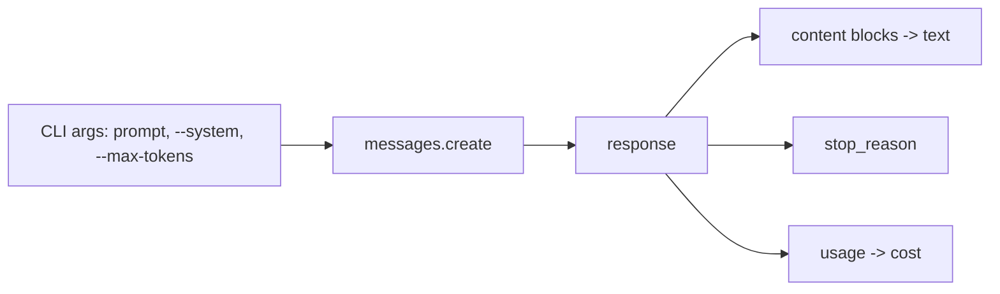

# 01 - Single LLM call

A command-line script that sends one prompt to Claude and prints the answer along with the stop reason, token counts and what the call cost. It's the smallest possible starting point for everything else in this repo.

Concepts: the Messages API, system prompts vs. messages, content blocks, `stop_reason`, token usage and cost.

## How it works



Each call is a single stateless request. The model doesn't remember anything between runs, so if I wanted a conversation I'd have to send the whole history back every time. The script logs what it sends (`-->`) and what comes back (`<--`) so I can see exactly what happened on each call.

## Running it

Needs [uv](https://docs.astral.sh/uv/) and an Anthropic API key.

```bash
cd basics/01-single-call
cp .env.example .env    # add your ANTHROPIC_API_KEY
uv run main.py "What is agentic AI?"
uv run main.py "What is agentic AI?" --system "You are a pirate." --max-tokens 50
```

## Example output

```
--> claude-haiku-5-5 | max_tokens=500
    system: You are a concise assistant. Answer in at most three sentences.
    user:   What is agentic AI?
<-- stop_reason=end_turn | in=37 out=115 tokens | $0.000061 | num_blocks=1

Agentic AI refers to AI systems that can pursue goals autonomously by planning
multi-step actions, using tools ...
```
