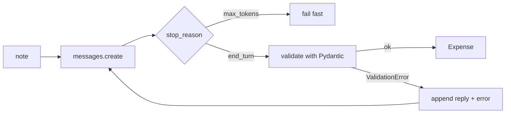

# 02 - Structured output

Turns a messy expense note like "uber home 23.40" into a validated `Expense` object. There are two versions: `main.py` does it by hand (schema in the prompt, parse, validate, retry), and `native.py` uses the API's built-in structured outputs so I could see what that actually replaces.

Concepts: JSON schemas, Pydantic validation, retrying with the validation error, nullable fields, constrained decoding, checking `stop_reason` before trusting the output.

## How it works



`main.py` builds the JSON schema from the Pydantic model and puts it in the system prompt, so the prompt and the validator can't drift apart. The reply goes through `strip_code_fences` and then `Expense.model_validate_json`. If validation fails, the model's reply and the error go back into the conversation and it gets another try, up to three. A reply cut off by `max_tokens` doesn't get retried, since it would just get cut off again.

`native.py` passes the schema through `output_config` instead, which constrains the output so it's always complete JSON with every key and the right types. The API can't enforce everything though: `gt=0` and the currency regex only end up as hints in the schema description, so Pydantic still validates. I use `create()` rather than `parse()` because `parse()` validates inside the call, which means a truncated reply raises a `ValidationError` before I can look at `stop_reason`.

## Running it

Needs [uv](https://docs.astral.sh/uv/) and an Anthropic API key.

```bash
cd basics/02-structured-output
cp .env.example .env    # add your ANTHROPIC_API_KEY
uv run main.py "uber home 23.40"
uv run main.py --demo
uv run main.py --max-tokens 20 "uber home 23.40"
uv run native.py --demo
```

## Example output

This is `main.py` on "coffee", back when `amount` was required:

```
--> 'coffee'
  attempt 1: stop_reason=end_turn | in=467 out=36 | $0.000065
    raw: '{"merchant": "coffee", "amount": null, ...}'
    parse error: amount - Input should be a valid number
  attempt 2: stop_reason=end_turn | in=599 out=77 | $0.000098
    raw: 'The schema requires `amount` to be a number greater than 0, and the note "coffee" doesn't state an amount...'
  attempt 3: stop_reason=end_turn | in=800 out=39 | $0.000100
    raw: '{"merchant": "coffee", "amount": 0.01, ...}'
<-- {'merchant': 'coffee', 'amount': 0.01, ...}
```

The model was honest twice, the schema rejected both answers, and on the third try it made up a number that passed.

## What I found

Retries push the model toward passing validation, not toward the truth. Once I made `amount` nullable, "coffee" came back as `amount: None` in one attempt for about a quarter of the cost.

Contradictions are expensive. With `currency` required and the prompt saying "don't guess", the retry for "uber home 23.40" spent all 500 tokens in a `thinking` block and returned no text, at 5x the cost of the first attempt. That's how I found out Haiku 5.5 has adaptive thinking on by default. I turned it off since this task doesn't need it.

Validation checks shape, not truth. "Paid rent" came back with "Rent" as the merchant until I added a separate `product` field, the tip on the taco lunch just got dropped, and "yesterday" became `null` because the model doesn't know today's date.

Native structured outputs weren't cheaper. `native.py` used about 780 input tokens per note against about 480 for `main.py`, so the API adds more to the context than my schema prompt did. What it buys is no fence stripping and far fewer bad replies, and one retry in `main.py` costs more than that overhead.

If I kept going, I'd pass today's date in the prompt so relative dates resolve, and decide what the caller should do with an expense that has no amount instead of printing it as a success.
