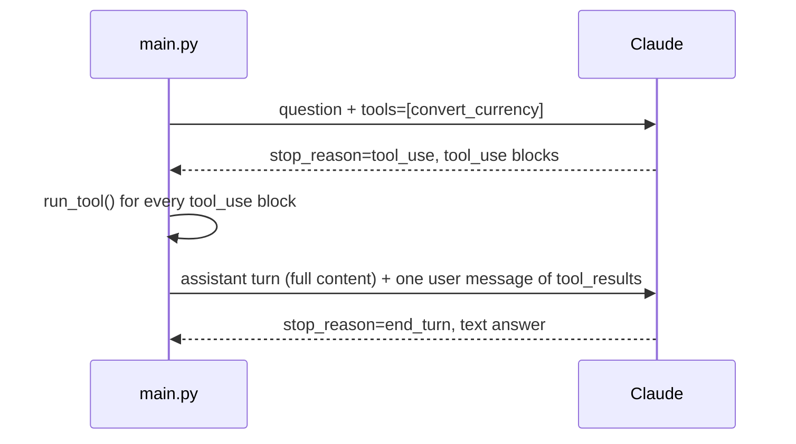

# 03 - Tool use

Answers money questions with one tool, `convert_currency`. The model decides when to call it, my code runs the conversion, and the result goes back to the model so it can write the answer. I did the `tool_use` / `tool_result` round-trip by hand, once, with no loop.

The exchange rates are made up on purpose. The model can't know them, so if an answer has them in it, they came from the tool.

Concepts: tool definitions, `stop_reason="tool_use"`, matching `tool_result` to `tool_use` by id, returning errors to the model with `is_error`, parallel tool calls.

## How it works



The tool's `input_schema` comes from a Pydantic model (`ConvertInput`), same idea as 02. The model's input isn't guaranteed to match it, so `run_tool` validates it again before converting. `run_tool` never raises: a bad input, an unknown currency or an unknown tool name all come back as a `tool_result` with `is_error: True` and a message the model can act on.

If the model asks for a tool a second time, I stop and say so instead of running it. (May be I will implement this later in another exercise)

## Running it

Needs [uv](https://docs.astral.sh/uv/) and an Anthropic API key.

```bash
cd basics/03-tool-use
cp .env.example .env    # add your ANTHROPIC_API_KEY
uv run main.py "How much is 1,850 EUR in USD?"
uv run main.py --demo
uv run main.py --no-tools "How much is 1,850 EUR in USD?"
uv run pytest
```

## Example output

Two currencies in one question, so the model asked for both conversions in the same reply:

```
--> "I spent 23.40 GBP and 3,200 JPY on a trip. What's that in USD?"
  model call: stop_reason=tool_use | in=693 out=216 | $0.000177
    blocks: ['text', 'tool_use', 'tool_use']
  tool call: convert_currency({'amount': 23.4, 'from_currency': 'GBP', 'to_currency': 'USD'}) id=toolu_01EeZiDEqTytJF48yc4w6UGJ
  tool result: 23.4 GBP = 30.65 USD
  tool call: convert_currency({'amount': 3200, 'from_currency': 'JPY', 'to_currency': 'USD'}) id=toolu_01Suwdyc1ohzwD5RqFURepFZ
  tool result: 3200.0 JPY = 22.72 USD
  model call: stop_reason=end_turn | in=1000 out=57 | $0.000129
    blocks: ['text']
<-- Your 23.40 GBP is about $30.65 USD, and your 3,200 JPY is about $22.72 USD, for a total of roughly $53.37 USD.
```

## What I found

Tools cost tokens on every call, used or not. "How much is 1,850 EUR in USD?" was 69 input tokens without the tool and 676 with it. "What's the capital of France?" paid about the same 670 and never touched the tool.

With `--no-tools` but the system prompt still telling it to use the tool, the model wrote out a fake tool call as plain text and then a made-up line saying the tool didn't return anything. `stop_reason` was `end_turn` and there was no `tool_use` block, so my code didn't run anything. A tool call only counts if it's a `tool_use` block, never something parsed out of the text.

Where the supported currencies are listed changes what the model does. With them in the tool description, "Convert 50 USD to BTC" was refused without calling the tool. With them removed from the description and the error message, the model called the tool, got the error back and explained it fine, but then offered to convert into "other supported currencies" it had no way of knowing. That's two calls instead of one and a vague answer, so the list goes in both places.

Every `tool_use` needs its `tool_result`, in the next message. When I sent back only the first of two results, the API rejected the request with a 400 naming the missing id, after both tools had already run and the first call was already paid for.

The model did the addition in the trip total ($53.37) itself. It was right, but nothing checked it.

"Convert 100 USD to EUR, then convert that result to JPY" needs the first answer before it can make the second call, so it hit my one-round limit.
