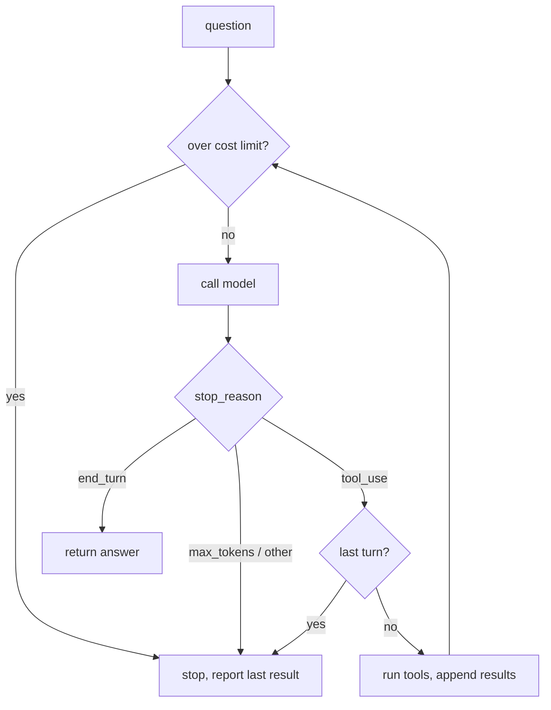

# 04 - Agent loop

Same currency tool as 03, but `ask()` is now a loop instead of one hand-written round-trip. The model keeps asking for tools until it has what it needs, and my code stops it if it runs too long or costs too much.

Concepts: the agent loop, checking `stop_reason` every turn, turn and cost limits, reporting partial progress when a limit hits, the model recovering from a tool error on the next turn.

## How it works



There's one `call_model` in the loop. Each turn it either ends, stops on a limit, or runs the tools and goes round again. The whole history is sent every turn.

Limits are `MAX_TURNS = 6` and `MAX_COST_USD = 0.01` per question. On the last turn I don't run the tools the model asks for, since no model call would ever read their results. The cost check runs before each call, so it's a soft limit: the call that goes over still finishes. When either limit hits, the answer says how far it got (the last successful tool result).

## Running it

Needs [uv](https://docs.astral.sh/uv/) and an Anthropic API key.

```bash
cd basics/04-agent-loop
cp .env.example .env    # add your ANTHROPIC_API_KEY
uv run main.py "Convert 100 USD to EUR, then convert that result to JPY"
uv run main.py --demo
uv run pytest
```

## Example output

Each step needs the previous result, so the model makes the calls one at a time:

```
--> 'Convert 100 USD to EUR, then convert that result to JPY'
  turn 1
  model call: stop_reason=tool_use | in=683 out=126 | $0.000131
    blocks: ['text', 'tool_use']
  total cost so far: $0.000131
  tool call: convert_currency({'amount': 100, 'from_currency': 'USD', 'to_currency': 'EUR'}) id=toolu_013jZaANEFvFQCpAcLHikHeE
  tool result: 100.0 USD = 88.5 EUR
  turn 2
  model call: stop_reason=tool_use | in=829 out=126 | $0.000146
    blocks: ['text', 'tool_use']
  total cost so far: $0.000277
  tool call: convert_currency({'amount': 88.5, 'from_currency': 'EUR', 'to_currency': 'JPY'}) id=toolu_016y1sJyDgbhsWoQBSMhHG9y
  tool result: 88.5 EUR = 14085.21 JPY
  turn 3
  model call: stop_reason=end_turn | in=977 out=31 | $0.000113
    blocks: ['text']
  total cost so far: $0.000390
<-- 100 USD is 88.5 EUR, which converts to 14,085.21 JPY.
```

The same five-step question with `MAX_TURNS = 2`, and then with `MAX_COST_USD = 0.0002`:

```
<-- Maximum number of turns reached: 2. The last result was: 100.0 USD = 88.5 EUR
<-- Cost limit exceeded: $0.000272. The last result was: 88.5 EUR = 76.34 GBP
```

## What I found

Input tokens grow every turn because the whole history goes back each time. The five-step chain (USD -> EUR -> GBP -> JPY -> INR -> USD) went 713, 866, 991, 1117, 1243, 1366, about 6,300 input tokens over 6 calls. Most of that is the system prompt and tool definition (~670 tokens) being resent every turn.

That chain used exactly 6 turns, five tool calls plus the answer, so it only just fit under `MAX_TURNS`. The limit has to come from the longest real task, not a round number.

It came back with 100.01 USD and the model called it "a gain of 0.01 USD". It's rounding: the tool rounds to 2 decimals and the model feeds the rounded value into the next call. The model can't know that. The fix belongs in the tool (keep full precision when the result feeds another calculation), not the prompt.

With the supported currencies removed from the tool description, "Convert 50 USD to CHF, or to EUR if CHF isn't supported" tried CHF, got the error with the list of codes, and retried with EUR on the next turn. In 03 it would have stopped after the error. With the list in the description it went straight to EUR: 2 turns instead of 3, for about 23 extra input tokens per call. The error message listing the codes is what made the retry possible.

My first version of the turn limit fell through to "Unexpected stop_reason: tool_use" on the last turn, and ran the tools anyway before stopping. Splitting "did the model ask for a tool" from "do I have turns left" fixed both.

The cost guard still lets one tool round run before it stops: in the second run above, EUR -> GBP ran on turn 2 and no model saw it. Checking cost after the call and before the tools would avoid that.
