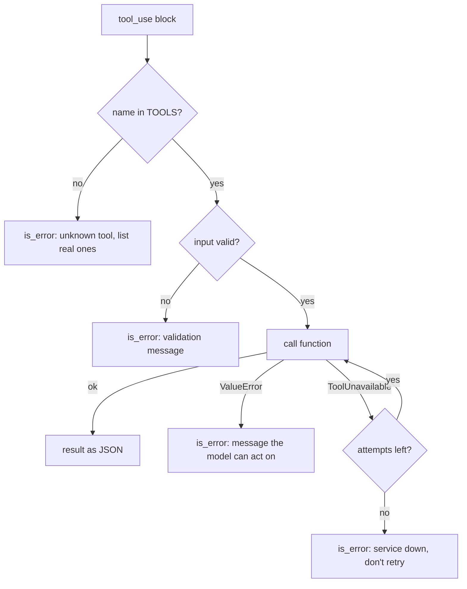

# 05 - Multiple tools

Same loop as 04, but the model now has three tools: `lookup_price` (made-up prices for a few items in four cities), `convert_currency` and `calculate`. It has to pick the right ones and chain them, e.g. look up two prices, convert both to USD, then add them.

Concepts: tool selection from names, descriptions and schemas, a tool registry for dispatch, and handling tool failures differently depending on whose fault they are.

## How it works

`TOOLS` maps each tool name to its input model, function and description. The definitions sent to the API are generated from it, so the tools the model is offered and the tools `run_tool` can run are always the same list.

`run_tool` handles four kinds of failure:



Bad input (unknown city, divide by zero) goes back to the model so it can fix the call. A timeout is retried in code, up to `TOOL_RETRIES = 2` extra attempts, because that's free and a retry by the model costs a whole call. Anything else is a bug in my code, so it's not caught.

`lookup_price` fails at random (`PRICE_FAILURE_RATE = 0.3`) to fake a flaky service.

## Running it

Needs [uv](https://docs.astral.sh/uv/) and an Anthropic API key.

```bash
cd basics/05-multiple-tools
cp .env.example .env    # add your ANTHROPIC_API_KEY
uv run main.py "How much is a coffee in Tokyo in USD?"
uv run main.py --demo
uv run pytest
```

## Example output

Five tool calls in four model calls. Calls that don't depend on each other come in the same turn:

```
--> "I'm buying a coffee in Tokyo and a coffee in London. What's the total in USD?"
  turn 1
  model call: stop_reason=tool_use | in=1194 out=159 | $0.000199
    blocks: ['text', 'tool_use', 'tool_use']
  tool call: lookup_price({'city': 'Tokyo', 'item': 'coffee'}) id=toolu_01T8DwsFFk5Ejpeg3Xsd8VkB
  tool result: {"price": 550, "currency": "JPY"}
  tool call: lookup_price({'city': 'London', 'item': 'coffee'}) id=toolu_013ptwHtXsoSTzXkZYL2wfh2
  tool result: {"price": 3.6, "currency": "GBP"}
  turn 2
  model call: stop_reason=tool_use | in=1449 out=216 | $0.000253
    blocks: ['text', 'tool_use', 'tool_use']
  tool call: convert_currency({'amount': 550, 'from_currency': 'JPY', 'to_currency': 'USD'}) id=toolu_01JqGMrQwUqCiVKawErw3EHD
  tool result: 3.91
  tool call: convert_currency({'amount': 3.6, 'from_currency': 'GBP', 'to_currency': 'USD'}) id=toolu_01UCuY47mamm976HTrjXaqmZ
  tool result: 4.72
  turn 3
  model call: stop_reason=tool_use | in=1731 out=80 | $0.000213
    blocks: ['tool_use']
  tool call: calculate({'operation': 'add', 'numbers': [3.91, 4.72]}) id=toolu_016qH9Ag75ps4meB5Y25suoc
  tool result: 8.629999999999999
  turn 4
  model call: stop_reason=end_turn | in=1823 out=55 | $0.000210
    blocks: ['text']
  total cost so far: $0.000875
<-- The two coffees come to about $8.63 USD in total (Tokyo ¥550 ≈ $3.91, and London £3.60 ≈ $4.72).
```

(Trimmed a few log lines per tool call.)

## What I found

Retrying in code is cheaper and more predictable than letting the model retry. With the price service always failing, `TOOL_RETRIES = 2` and a "service is down, don't retry" message took 3 attempts, 2 model calls and $0.000322. With no code retries and a plain "timed out" error, the model retried once on its own: 2 attempts, 3 model calls, $0.000524. Fewer attempts for 63% more money, and nothing but `MAX_TURNS` decided when it stopped.

Short descriptions mostly still worked, which surprised me. With `"Prices."` and `"Math."` the model still picked the right tools, because the names, the input schemas and the system prompt carry a lot of the same information. But for "which beer is cheaper and by how much" it skipped `calculate` and did the subtraction itself, while it still used `calculate` for the addition in another question. The full description says "use for any arithmetic instead of calculating yourself", and with that it used the tool every time.

Listing the cities and items in the `lookup_price` description means the model answered "what does a croissant cost in Paris?" without calling anything (1 call, $0.000147). With the short description it called the tool, read the error listing the items, and answered on the next turn (2 calls, $0.000282). The listing costs about 156 input tokens per call, so one wasted round-trip uses up about 9 calls' worth of savings.

Three tools cost about 1,170 input tokens per call before anything happens, against about 680 with one tool in 04. That's paid on every turn, including "What's the capital of France?", which uses no tools.

Bugs I hit on the way: the description builder put the intro text between the city lines, because adjacent string literals are joined before `.join()` runs. And my first retry loop made one attempt fewer than `TOOL_RETRIES` said (two tries, one retry), so `TOOL_RETRIES = 0` never ran the tool at all.

`calculate` doesn't round, so the model sees things like `8.629999999999999` and rounds when it answers. Real money code would use `Decimal` or integer cents.
