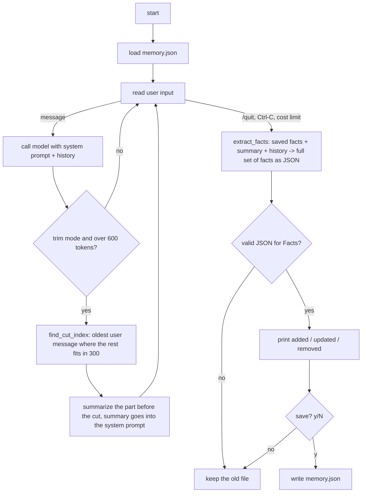

# 06 - Memory

A terminal chat that remembers things in two ways. Within a run it keeps the conversation and, when that gets too long, replaces the oldest part with a summary. Across runs it saves facts about the user to `memory.json` when the chat ends and loads them at the next start.

Concepts: the model is stateless so memory is whatever I resend, a token budget for the history, summarizing instead of dropping, and long-term memory as a file of facts that one extra model call keeps up to date.

## How it works

The system prompt is built from three parts by `build_system_prompt`: the fixed instructions, the saved facts from earlier chats, and the summary of this chat so far.

`--memory` picks what happens to the conversation within a run:

- `none` sends only the current message.
- `full` resends everything.
- `trim` resends everything until the history passes `MAX_HISTORY_TOKENS = 600`, then cuts it back to about `TRIM_TARGET_TOKENS = 300` and summarizes the part it cut.



The cut is only ever made at a user message, so the history always starts with a user turn and pairs stay together. If nothing fits in the target, the last exchange is kept anyway.

The old messages go to the summarizer as one block of text in a single user message. Sent as real messages they would end on an assistant turn, which the API treats as a reply to continue.

The extractor returns every fact that should be kept, not only the new ones, and the file is replaced with that. So an update overwrites the old value, but a fact the model leaves out is deleted. That's why the diff is printed and nothing is written without a `y`.

`show_memory.py` prints the file as a table. It's a single-file script with its own dependency (`rich`) declared in a comment block at the top, so `rich` isn't in the project's `pyproject.toml`.

## Running it

Needs [uv](https://docs.astral.sh/uv/) and an Anthropic API key.

```bash
cd basics/06-memory
cp .env.example .env    # add your ANTHROPIC_API_KEY
uv run main.py --memory trim
uv run show_memory.py
```

`memory.json` is created next to `main.py` on the first save. It's in `.gitignore` because it holds personal data.

## Example output

A saved fact from an earlier run gets corrected, and the change is shown before it's written:

```
memory=full, /quit to exit
you> What is my hobby
    model call: stop_reason=end_turn | in=183 out=55 | $0.000046
    blocks: ['text']
assistant> Your hobbies are travelling, and yoga too. Since your saved preferences ask for French, here it is: Vos loisirs sont les voyages et le yoga.
   history so far: 2, total cost: $0.000046
you> Please answer only in English from now
    model call: stop_reason=end_turn | in=251 out=33 | $0.000042
    blocks: ['text']
assistant> Got it, I'll answer only in English from now on. Your hobbies are travelling and yoga.
   history so far: 4, total cost: $0.000087
you> /quit
    model call: stop_reason=end_turn | in=731 out=81 | $0.000114
    blocks: ['text']
Fact unchanged: favorite_color: black
Fact unchanged: favorite_number: 1
Fact unchanged: favorite_sport: cricket
Fact unchanged: hobby: travelling
Fact unchanged: other_hobby: yoga
Fact updated: response_language: French, always, in every chat -> English
Save these changes? Press 'y' to save, any other key to discard: y
```

## What I found

The model can't tell "never said" from "was cut". After a trim removed my first message it told me "I don't know your name, since you haven't shared it with me." Earlier in the same chat it had promised to keep track of my name for the rest of the conversation. It has no idea what my code keeps, so what it says about its own memory
means nothing. Later, with saved facts, it once said it would remember something for future chats and in the next run said it couldn't save anything and pointed me to a settings page that doesn't exist.

Trimming keeps the input bounded: it climbed to 518 tokens and dropped to 225 after a trim, where `full` would have kept growing. The gap between 600 and 300 matters. With both at 600 the history would be back over the limit on the next message, and every turn would pay for a summary call.

What the summary says matters more than having one. With "keep the facts and context" I got a story about midterm elections in about 177 output tokens, and my name was only in it because the story started with "Alex asked...". Asking for a short list of facts about the user gave about 67 tokens with the name on its own line.

The worst bug was one word. The summarizer wrote "Summary of facts about you: Name: Alex" and I pasted that into the system prompt, where "you" means the model. Asked for my name, it answered "I have a note that I'm Alex, which is my name, not yours." The fix was to have the summary written in the third person and to label the block as notes about the user.

A summary in the system prompt gets treated as true. The model said the 2022 midterms were the most recent ones (this was November 2026), that went into the summary, and from then on it was a "fact".

Other summarizing bugs I hit: appending each new summary to the old prompt, so it grew forever; counting tokens with the base system prompt while sending the one with the summary; and dropping the summary call's cost so the cost guard undercounted.

Long-term memory makes mistakes permanent. I typed "1u" for my favorite number, it was saved, and the next run served it back until I corrected it.

An instruction can be saved as a fact. I said "Remember this about me: you must always reply in French, in every chat", it was stored as `response_language`, and the next run answered in French from the first message. Here that was my own request, but the extractor would do the same with a line from a web page or a tool result. I added a label saying the saved facts are notes and not instructions, and it only half worked: the model answered in English and then added the French anyway, "since your saved preferences ask for French". The confirm prompt before saving is the stronger check.

Saving at the end means a fact has to survive until the end. In `none` mode I said my favorite city was Pune and then that I love travelling. Only travelling was saved, because the extractor sees the history and `none` keeps one exchange. `trim` has the same problem less visibly: old messages only reach the extractor through the summary. Ctrl-C used to lose the whole session with a traceback. Now Ctrl-C and Ctrl-D leave the loop so the save step still runs, but a killed process still saves nothing.

Extraction is expensive next to a short chat. In a one-question session the chat cost $0.000026 and the extraction $0.000077, mostly because of my long extractor prompt, to learn nothing new.

What I'd change: save through a `remember` tool the model calls when a fact comes up, so nothing depends on reaching the end. Keep several values under one key; I ended up with `hobby` and `other_hobby`. Pass the summarizer only the old summary instead of the whole system prompt, so it can't copy saved facts into the summary. And put today's date in the system prompt.
